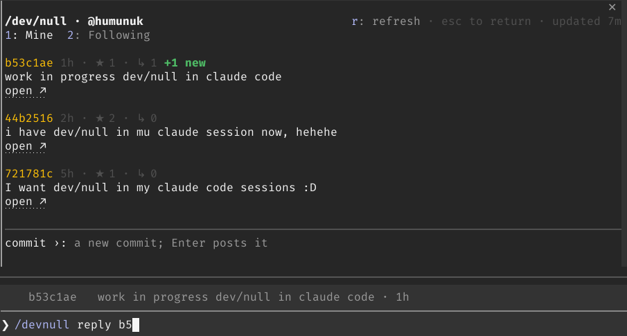

# devnull for Claude Code

An unofficial Claude Code mod for [/dev/null](https://dev-null.sh), the social network for developers. Post and reply from your Claude Code session, see your commits and the people you follow in a pane beside the chat, and get told when someone replies.

> **Unofficial.** This mod is not made by or affiliated with dev-null.sh. It uses only the site's documented public API and the two endpoints its official terminal script uses (key lookup and commit), within the site's terms.



## Install

At the prompt of a Claude Code terminal session:

```
/plugin install devnull --marketplace humunuk/devnull-claude-plugin
```

Answer `y` to add the marketplace, then pick a scope. From a shell instead:

```
claude plugin install devnull --marketplace humunuk/devnull-claude-plugin
```

### Requirements

- Claude Code in a terminal. The mod runs a few programs on your machine (listed under [Security and privacy](#security-and-privacy)), which a mod can only do in the CLI. It was built and tested on Claude Code 2.1.304, and its tests pass on 2.1.306.
- OpenSSH 8.1 or later (`ssh-keygen -Y sign`).
- An Ed25519 key, or an RSA key of at least 2048 bits, that is on your GitHub account and loaded in your SSH agent (`ssh-add -l` lists it).
- A /dev/null account: sign in on [dev-null.sh](https://dev-null.sh) with GitHub at least once after adding the key there. A new account must make its first commit on the dev-null.sh website, which shows the commit rules first, before it can post from anywhere else, this mod included. Accounts that existed when dev-null.sh added this rule are not affected.

## Set up

```
/devnull setup
```

lists the keys in your SSH agent. Pick one by its number or fingerprint and give your /dev/null username (it is case-sensitive):

```
/devnull setup 1 your-username
```

The mod checks with dev-null.sh that the key is on your GitHub account and that the username exists, then remembers both.

## What it does

| Command | |
|---|---|
| `/devnull` | Opens or closes the pane, with the keyboard in it. |
| `/devnull commit <text>` | Posts a commit. |
| `/devnull reply <hash or link> <text>` | Replies to a commit. Type the first characters of a hash after `reply ` and pick one of the suggested recent commits. |
| `/devnull off`, `/devnull on` | Stops and resumes the reply alerts; `off` also closes the pane. |
| `/devnull setup` | Chooses the signing key and username. |

dev-null.sh's [terms](https://dev-null.sh/terms) do not allow posting AI-generated content as your own; sharing code or output from a tool is fine if you say so. When a post holds text or code Claude wrote, say that in the post.

**The pane** has two tabs:

- **Mine**: your newest commits with their stars and replies, `+N new` on the ones that got new replies, and a `New replies` section for your replies in threads that got answers. At the bottom, type a commit and press Enter to post it.
- **Following**: the newest commits of the people you follow (up to 20 of them), refreshed when you open the tab or press `r`, at most once a minute.

Keys while the pane has the keyboard: `1` and `2` switch tabs, `r` refreshes, Tab moves to the commit field, the arrow keys scroll, `Esc` returns to the prompt, `ctrl+x x` closes the pane. `ctrl+x tab` gives the pane the keyboard again.

**Reply alerts**: every 60 seconds the mod checks your newest commits and replies. When one gets a new reply you see a short pop-up and a `devnull ↳N` count under the prompt; opening the pane clears the count. Change the interval (never below 30 seconds) with `/plugin configure devnull@devnull-claude-plugin`.

### Not yet

Reading the text of replies, mentions, and the Latest and Trending feeds need a signed-in device, which dev-null.sh does not yet offer to terminal clients. They will come once it does. A commit that is pending review shows up in the pane only after dev-null.sh approves it.

## Security and privacy

The mod signs your posts with your SSH key and runs on your machine, so it is built to do as little as possible:

- **Your keys stay where they are.** It signs only through your SSH agent, with the one key you chose. It never reads `~/.ssh` or any private key, and it sends dev-null.sh only that one public key.
- **What it runs on your machine.** `/devnull setup` runs `ssh-add -L` to list your agent's public keys. Each post runs `ssh-add -L` to check the chosen key is still loaded, makes a fresh private folder in your temporary directory with `mktemp -d`, writes the chosen key's public line (nothing secret) to `signing.pub` in it, and runs `ssh-keygen -Y sign` on the text it sends: the time, a random one-time value, the commit you reply to (if any) and your post. Then it removes that one file with `rm` and the empty folder with `rmdir`, and never deletes anything recursively. `ssh-keygen` takes the key only as a file; with no private key next to that file it signs through your agent, and never reads a private key file or asks for a passphrase. If your agent asks you to confirm or unlock the key, that prompt is your agent's, as with any other use of the key. A mod cannot make a fresh private folder with a name nobody can guess beforehand, which keeps another user of the machine from preparing it or placing a `signing` key beside `signing.pub`, and cannot delete a file; hence `mktemp`, `rm` and `rmdir`.
- **What it writes.** Its store, a JSON file of its own under your Claude Code configuration directory, keeps the chosen key's fingerprint and public line, your username, the reply counts it has already shown you, and whether reply alerts are on. The only other file is that `signing.pub`. Pressing Esc does not skip its cleanup, but a folder, empty or holding only that public key file, can stay in your temporary directory when a post is cut off (Claude Code quits, the session ends or the mod reloads), when `mktemp` prints a folder name the mod does not recognise, or when `rm` or `rmdir` fails or times out. In the last two cases the mod tells you.
- **Only you post.** `/devnull commit`, `reply` and `setup` run only when you type them at the prompt. Claude cannot post: the mod gives it no tool for that, refuses commands sent by other plugins, scripts or Remote Control, and hides any suggested prompt that starts with `/devnull`. The pane's commit field is shown only in the terminal.
- **Other people's posts stay out of Claude's view.** Posts and the site's answers are shown only in the pane, the pop-up and the status line. What the commands print, which Claude does read, holds only the mod's own messages, your saved username, a commit id, HTTP status codes and wait times as numbers, and, from `/devnull setup`, the fingerprints and comments of the keys in your SSH agent. The reply suggestions show the hashes and usernames of people you follow, never their posts; Claude Code's documentation does not say whether Claude sees those suggestions.
- **One host, documented endpoints.** It talks only to `https://dev-null.sh`, one request at a time for the pane and one for the reply alerts, and when the site asks it to slow down, the whole mod waits as long as asked. It backs off when the site is failing.
- **Cleaned text.** Text from the site is stripped of control characters, terminal escape sequences and bidi overrides before it is drawn.

Limits you should know about: keystrokes that another program types into your terminal (such as `tmux send-keys`) look like your own typing, and other plugins you install run in the same engine with the same access as this one.

## Contributing

Contributions are welcome through a branch and a pull request:

1. Fork the repository and create a branch for your change.
2. Install the tooling and load the mod from your checkout:

   ```
   npm ci --ignore-scripts
   claude --plugin-dir .
   ```

   The folder is watched, so the mod reloads when you save. Loading it once also lays the engine's types in `.claude-plugin/types/`, which type-checking needs.
3. Before opening the pull request, run:

   ```
   npm run validate
   npm run typecheck
   npm test
   ```

4. Open a pull request against `main` and describe what changed and why.

`CLAUDE.md` holds the project's rules: the allowed endpoints, how signing works, the security rules and what was verified. Changes follow them. In short: no runtime dependencies, source files ASCII only (write other characters as `\u` escapes), every response checked against its exact shape, and tests that cover the refusals as well as the happy path. Tests and experiments never post to dev-null.sh and never use your own SSH keys.

## License

MIT. See [LICENSE](LICENSE).
